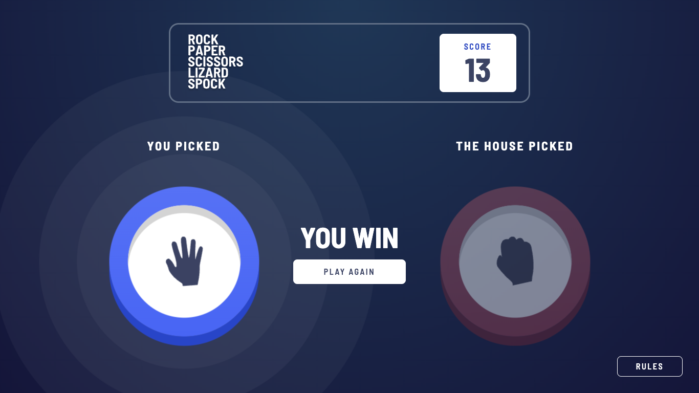
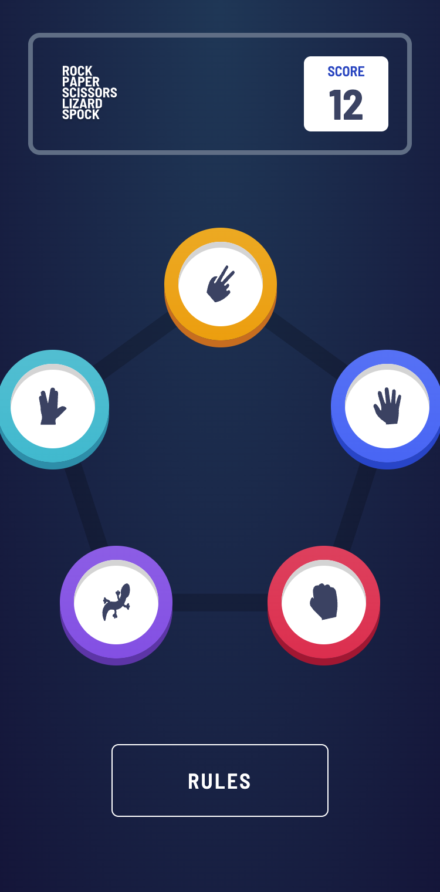
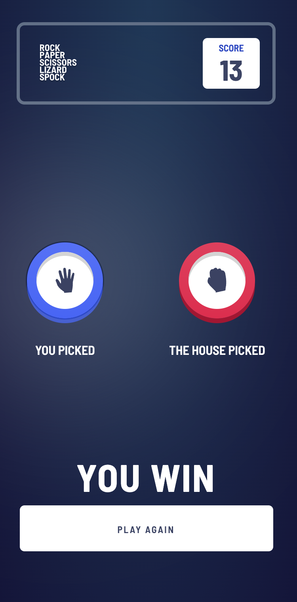

# Rock, Paper, Scissors, Lizard, Spock

[](https://github.com/mcameloa/rock-paper-scissors-lizard-spock/actions/workflows/ci.yml)

The five-option version of Rock, Paper, Scissors, played against the computer. Built with React,
TypeScript and Tailwind CSS. It is responsive, can be played with the keyboard, and keeps the score
between visits.

**[Play it live](https://mcameloa.github.io/rock-paper-scissors-lizard-spock/)**



| Pick your move | Result |
|---|---|
|  |  |

## Features

- Play a round against the house: a roulette spins through the options, slows down and lands on
  the house's pick (a still slot instead when the system asks for reduced motion)
- A glow on the winning pick, the outcome, and a score that goes up or down by one
- The score is kept in `localStorage` and survives reloads (blocked or corrupt storage falls back to 0)
- Rules dialog: closes with Escape, the close button or a click outside, and gives focus back to
  the Rules button
- Fully keyboard playable, with labelled buttons, a single page heading and live regions for the
  score and the outcome
- Mobile and desktop layouts that follow the design

## Rules

Each option beats two others and loses to the other two:

| Option | Beats |
|---|---|
| Scissors | Paper, Lizard |
| Paper | Rock, Spock |
| Rock | Lizard, Scissors |
| Lizard | Spock, Paper |
| Spock | Scissors, Rock |

## Tech stack

React 19, TypeScript 6, Vite 8, Tailwind CSS 4, Vitest 5 with Testing Library, ESLint 10, and
GitHub Actions (CI and GitHub Pages).

## Getting started

Requires Node 22.12 or later (`.nvmrc` pins the LTS used here).

```sh
nvm use
npm install
npm run dev
```

| Script | What it does |
|---|---|
| `npm run dev` | Starts the dev server |
| `npm test` | Runs the tests in watch mode (`npm run test:run` runs them once) |
| `npm run lint` | Runs ESLint |
| `npm run typecheck` | Runs the TypeScript compiler without emitting files |
| `npm run build` | Type-checks and builds to `dist/` |
| `npm run preview` | Serves the production build |

## Project structure

```
src/
├── Game.tsx              # Page layout; wires state to the views
├── hooks/
│   ├── useGame.ts        # Round state machine: picking → revealing → result
│   └── useStoredScore.ts # Score that persists in localStorage
├── utils/
│   ├── constants.ts      # Options, BEATS table, score deltas, texts
│   ├── functions.ts      # Pure logic: getOutcome, getRandomOption, roulette plan, pentagon geometry
│   └── types.ts          # OptionName, Outcome, GameState
├── views/                # Selection (pentagon) and Result screens
└── components/           # Option, Roulette, Score, Rules dialog, buttons
```

## Design decisions

- **Rules as data.** `BEATS` maps each option to the two it defeats, and `getOutcome` is a pure
  function over it. Adding or changing a rule is a one-line edit, and the tests check all 25
  pairings against the rules table written out independently.
- **A small state machine.** A round is a tagged union (`picking`, `revealing` or `result`), so
  impossible states such as an outcome with no house pick cannot be represented. `useGame` owns
  the transitions and cancels the pending reveal on unmount or reset, so a late timer can never
  change the score. The house picks as soon as you do, so the roulette can land on that pick;
  the outcome stays hidden until the reveal.
- **Accessible by default.** Options are real buttons, the rules are a modal dialog, and tests
  query by role and label, the same way a screen reader user finds things.
- **Behaviour tests over snapshots.** Full rounds run with fake timers and deterministic house
  picks, instead of brittle markup snapshots.

## Origin and credits

This started as a frontend take-home exercise and was later updated and refactored for this repo.
The design, icons and style guide come from the
[Rock, Paper, Scissors challenge](https://www.frontendmentor.io/challenges/rock-paper-scissors-game-pTgwgvgH)
by [Frontend Mentor](https://www.frontendmentor.io). See [`style-guide.md`](style-guide.md) for
the colors and fonts.

## License

[MIT](LICENSE). The design assets belong to Frontend Mentor.
